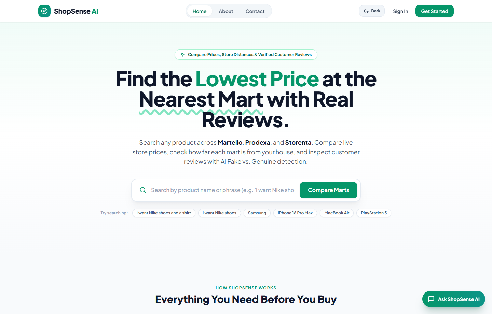
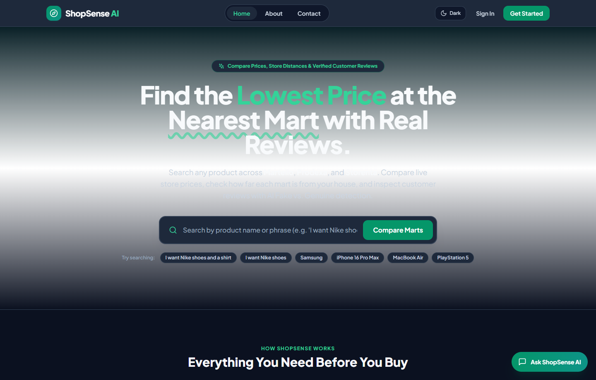
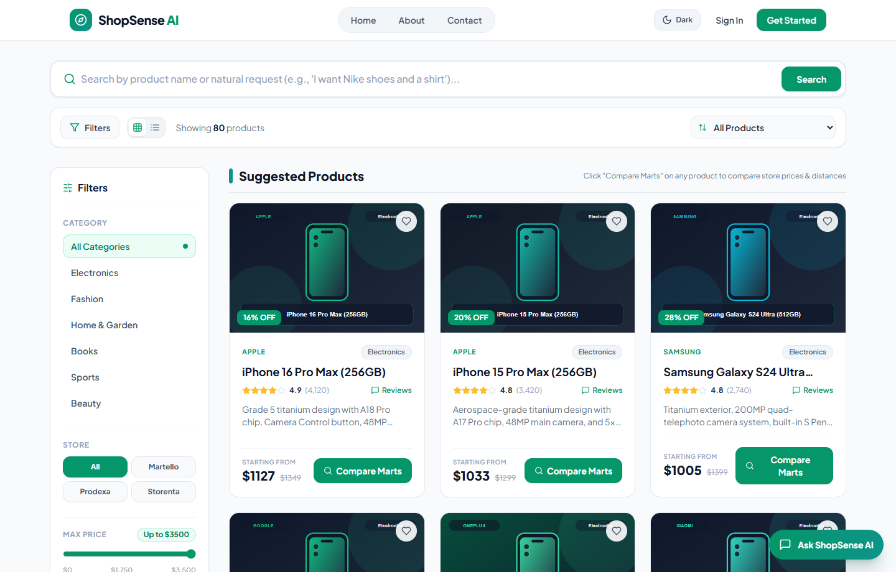
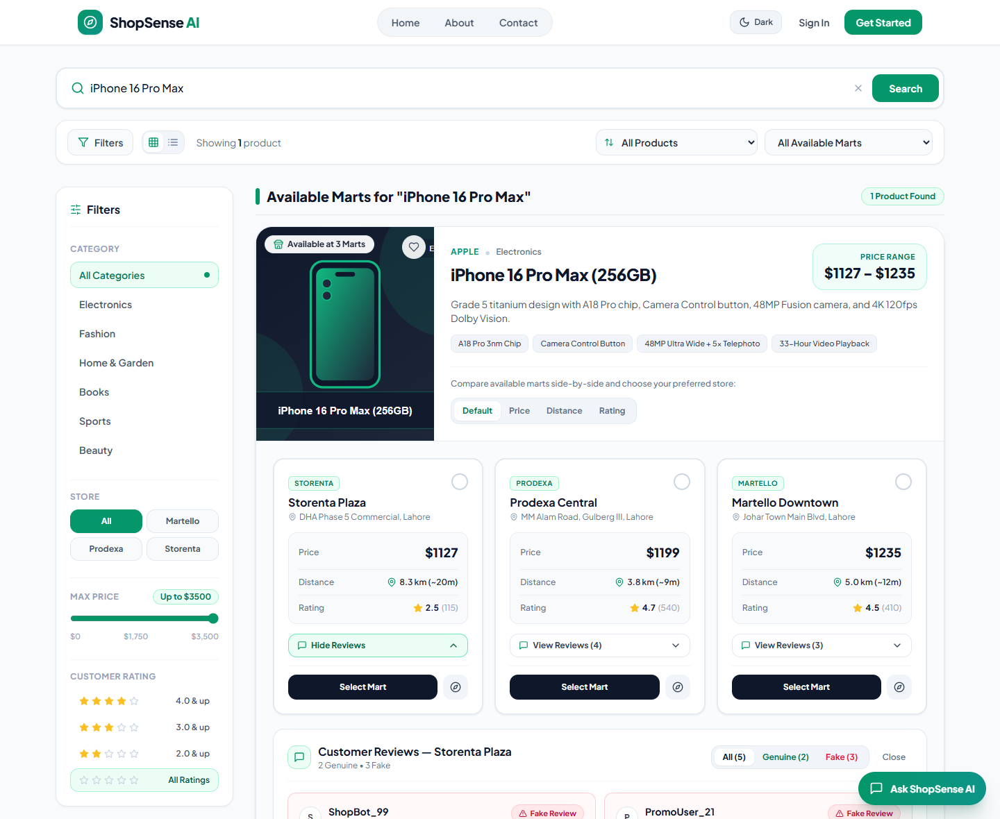
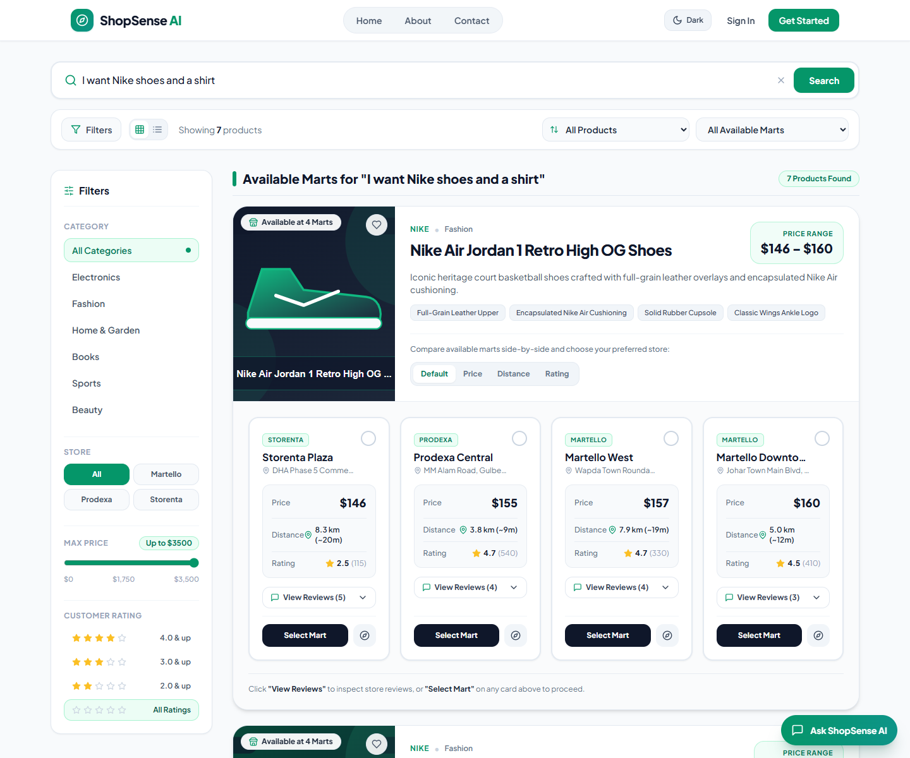
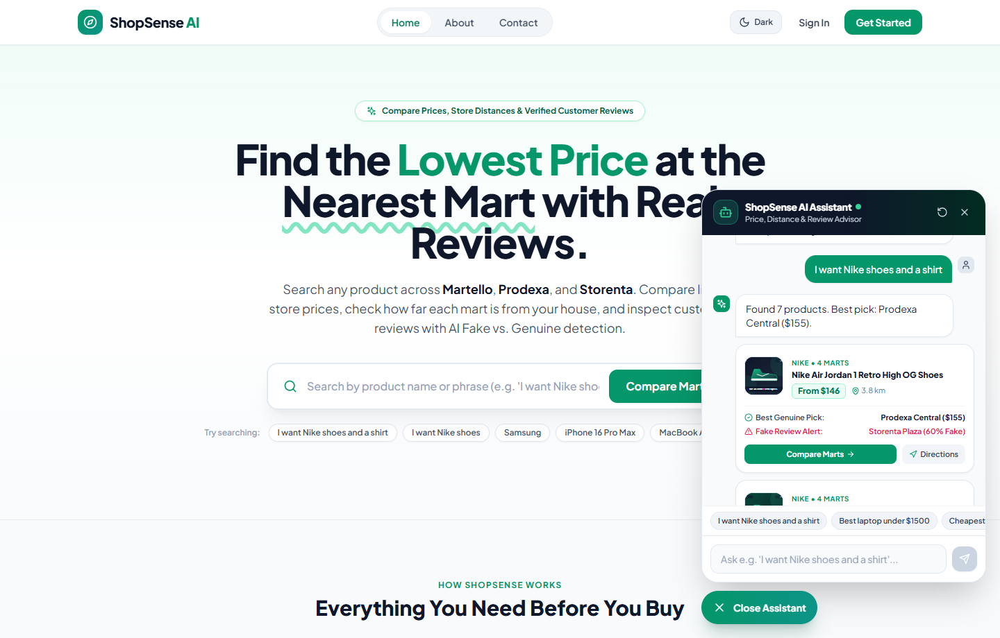
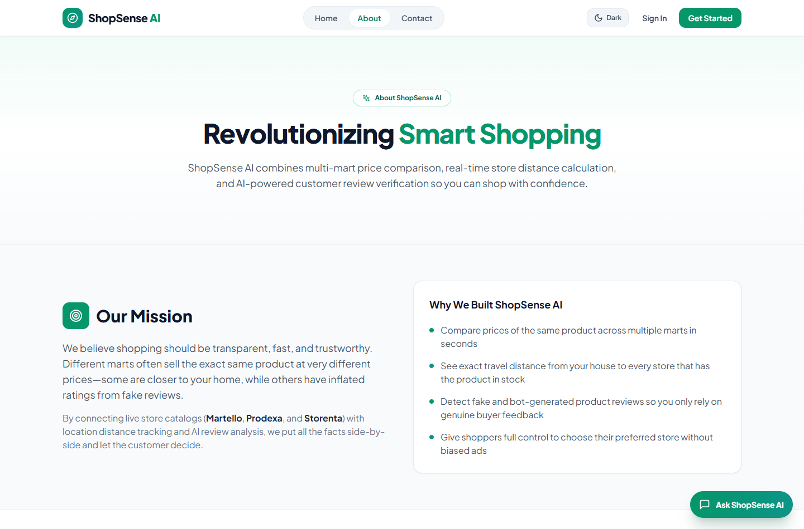

# ShopSense AI — Smart Multi-Mart Price, Distance & Review Comparison Platform

**ShopSense AI** is a full-stack intelligent shopping comparison platform built with the **MERN Stack (MongoDB, Express.js, React + TypeScript, Node.js)** and **Hugging Face BERT (`@xenova/transformers`)**.

It empowers shoppers to search products by exact name or natural conversational phrases across local marts (**Martello Downtown**, **Martello West**, **Prodexa Central**, and **Storenta Plaza**) and compare:
1. **Real-Time Mart Prices** (with original prices and discounts across 50+ products per mart)
2. **Live Distance (`km`) & Drive Time (`mins`)** from the customer's location using the Haversine formula
3. **Customer Reviews Classified as `Genuine Review` or `Fake Review`** by a local **66M-parameter Hugging Face DistilBERT Transformer model** (`Xenova/distilbert-base-uncased-finetuned-sst-2-english`)
4. **ShopSense AI Shopping Assistant Chatbot** for interactive product discovery, budget filtering, distance checks, and review trust advice

---

## Project Screenshots

### 1. Landing Page — Light Mode & Dark Mode (Slate & Emerald Theme)
ShopSense AI features a unified **Slate & Emerald** design system (`Plus Jakarta Sans` typography) with instant **Light Mode / Dark Mode** switching persisted in `localStorage`.

| Light Mode | Dark Mode |
| :---: | :---: |
|  |  |

---

### 2. Product Catalog Browsing (50+ Products per Mart Across 6 Categories)
When customers browse the catalog without searching for a specific item, **ShopSense AI** displays clean, standard product cards with category-matched product studio illustrations, store filters, price range controls, and rating filters—without cluttering the screen with mart locations.



---

### 3. Specific & Conversational Product Search — Side-by-Side Mart Comparison & Genuine/Fake Review Badges
When a customer searches for a specific product (e.g., `iPhone 16 Pro Max`), a conversational request (e.g., `I want Nike shoes and a shirt`), or clicks **`Compare Marts`**:
- **Only the marts where that product is actually in stock are shown** (some products are available at 1 mart, some at 2, 3, or all 4 marts).
- Each available mart row displays its **Price**, **Distance (`km`)** from the customer, and **Rating**.
- Clicking **`Customer Reviews`** opens the customer reviews for that mart, where each review carries a clear **`Genuine Review`** (green) or **`Fake Review`** (red) badge so the shopper can decide whether to prioritize a lower price, closer distance, or verified reviews.



---

### 4. Conversational & Multi-Item Natural Language Search (`"I want Nike shoes and a shirt"`)
Customers can search using natural language sentences or multi-item requests (e.g., `"I want Nike shoes and a shirt"`). The search engine parses each item clause and displays all matching products with their available marts, live prices, and distances.



---

### 5. ShopSense AI Shopping Assistant Chatbot
The floating **Ask ShopSense AI** assistant is accessible from the bottom-right corner of every page. Customers can ask for products, bundles, or budget constraints (e.g., `"I want Nike shoes and a shirt"` or `"Best laptop under $1500"`), view the **Best Genuine Pick** and **Fake Review Alerts** inside interactive chat cards, jump directly to full mart comparisons, or open Google Maps directions. When a customer says `"ok"` or `"thanks"`, the assistant asks *"Do you want something else?"* with **`Suggest Products`** and **`Leave`** buttons.



---

### 6. About Page — Platform Overview & Architecture


---

## How the Project Works (End-to-End Architecture)

```
+----------------------------------------------------------------------------+
|                        FRONTEND (React + TypeScript + Vite)                |
|  - Landing Page, Product Search, AI Chatbot, Dashboard, Wishlist, Auth     |
|  - Conversational multi-item search ("I want Nike shoes and a shirt")      |
|  - Calculates live GPS/Haversine distance (km) from user to each mart      |
|  - Shows normal cards on browse; shows available marts on product search   |
+---------------------------------------+------------------------------------+
                                        | REST API (Axios + Local Fallback)
                                        v
+----------------------------------------------------------------------------+
|                     BACKEND (Node.js + Express + MongoDB)                  |
|  - GET  /api/products                  -> Search & filter catalog          |
|  - GET  /api/marts                     -> 4 Marts with GPS coordinates     |
|  - GET  /api/stores/:storeName/products-> Dedicated Mart APIs              |
|  - POST /api/reviews/analyze           -> Live BERT Review Classifier API  |
|  - POST /api/chat                      -> Conversational AI Assistant API  |
+---------------------------------------+------------------------------------+
                                        | ONNX Runtime (Local Inference)
                                        v
+----------------------------------------------------------------------------+
|        HUGGING FACE BERT ENGINE (@xenova/transformers — DistilBERT)        |
|  - Model: Xenova/distilbert-base-uncased-finetuned-sst-2-english           |
|  - Tokenizes customer reviews with WordPiece & runs 6-layer Transformer    |
|  - Combines BERT sentiment probability + rating-sentiment consistency      |
|    + promotional spam detection to label reviews GENUINE or FAKE           |
+----------------------------------------------------------------------------+
```

### 1. Multi-Mart Catalog & Varied Stock Availability (50+ Products per Mart)
The platform stocks **68 distinct products** across **6 categories** (*Electronics, Fashion, Home & Garden, Books, Sports, Beauty*) distributed across **4 marts in Lahore** so that every mart carries more than 50 products:
- **Martello Downtown** — *Johar Town Main Blvd, Lahore* (`31.4697, 74.2728`) — **56 products in stock**
- **Martello West** — *Wapda Town Roundabout, Lahore* (`31.4312, 74.2644`) — **52 products in stock**
- **Prodexa Central** — *MM Alam Road, Gulberg III, Lahore* (`31.5102, 74.3441`) — **60 products in stock**
- **Storenta Plaza** — *DHA Phase 5 Commercial, Lahore* (`31.4625, 74.4085`) — **55 products in stock**

Not every product is sold at every mart—some products are stocked at **1 mart**, some at **2 marts**, some at **3 marts**, and some at all **4 marts**. If a product is not available at a particular mart, that mart is automatically excluded from the comparison view. Every product image is generated by `createProductImage` (`productImage.helper.js`) to match its exact brand, category, and product description.

### 2. Conversational & Multi-Item Natural Language Search
Customers are not limited to searching by exact model titles. Both the search engine (`ProductSearch.tsx` and `product.service.js`) and the **ShopSense AI Chatbot** parse conversational sentences and multi-item requests such as:
- `"I want Nike shoes"`
- `"I want Nike shoes and a shirt"`
- `"Best laptop under $1500"`
- `"Show me a phone and headphones"`

The parser splits conjunctions (`and`, `or`, `with`, `plus`, `,`), removes conversational filler words, expands category synonyms, and matches item keywords against product identity fields using word-boundary regular expressions.

### 3. ShopSense AI Shopping Assistant Chatbot
Located in `src/components/ChatBot.tsx` (and backed by `POST /api/chat`):
- **Concise Product & Budget Discovery:** Responds to product, bundle, and budget queries (`"under $1500"`) with concise single-line advice and interactive product cards.
- **Price, Distance & Review Trust Advisor:** Displays the lowest price, distance in `km` from the user's location, the **Best Genuine Pick**, and a **Fake Review Alert** when the lowest-price mart has high fake review inflation.
- **Interactive Follow-Up Controls:** When a customer replies `"ok"`, `"thanks"`, or `"done"`, the assistant asks *"Do you want something else?"* and provides **`Suggest Products`** and **`Leave`** action buttons.

### 4. Real Hugging Face BERT Review Authenticity Classifier
Located in `SSA-server/server/services/bert.service.js`:
1. **Transformer Inference:** Uses `@xenova/transformers` to load `Xenova/distilbert-base-uncased-finetuned-sst-2-english` locally in Node.js (no external API key required).
2. **Contextual Sentiment & Softmax Confidence:** Each review is tokenized and passed through the BERT model to extract `bertSentiment` (`POSITIVE` / `NEGATIVE`) and `bertSentimentScore` (`0.000` – `1.000`).
3. **Authenticity Classification (`GENUINE` vs. `FAKE`):**
   - **Sentiment–Rating Contradiction:** Flags 5-star reviews where BERT detects strong `NEGATIVE` sentiment and complaint terminology, or 1-star reviews with positive hyperbole.
   - **Promotional Bot Hyperbole:** Flags reviews with extreme BERT positive scores paired with generic spam phrases (`"100% original"`, `"buy now"`, `"A++++"`, `"best product ever"`), excessive exclamation marks, and zero concrete buyer details.
   - **Verified Buyer Experience:** Reviews mentioning concrete product/store details (factory seal, serial verification, warranty card, checkout wait time, evening parking) are labeled `GENUINE`.
4. **Genuine Rating Adjustment:** Filters out `FAKE` reviews to compute each mart's true `genuineRating` so bot-inflated 5-star reviews cannot mislead shoppers.

---

## API Endpoints

| Method | Endpoint | Description |
| :--- | :--- | :--- |
| `GET` | `/api/products` | Fetch & search products (supports conversational `?q=`, `?category=`, `?store=`, `?martId=`) |
| `GET` | `/api/marts` | Fetch all 4 mart locations with GPS coordinates (`lat`, `lng`) |
| `GET` | `/api/stores/:storeName/products` | Fetch products for a specific store (`martello`, `prodexa`, `storenta`) |
| `POST` | `/api/reviews/analyze` | Run live Hugging Face BERT classification on custom review text(s) |
| `POST` | `/api/chat` | Conversational AI Shopping Assistant endpoint (multi-item & budget search) |
| `POST` | `/api/auth/signup` | Register a new customer account |
| `POST` | `/api/auth/login` | Authenticate customer and receive JWT token |
| `GET` | `/api/auth/dashboard` | Fetch personalized user dashboard, wishlist, search history & recommendations |

### Example: Test Live BERT Classification (`POST /api/reviews/analyze`)
```bash
curl -X POST http://localhost:5000/api/reviews/analyze \
  -H "Content-Type: application/json" \
  -d '{
    "reviews": [
      {
        "user": "ShopBot_99",
        "rating": 5,
        "text": "Best product ever!!! 100% original buy now A++++!!"
      },
      {
        "user": "Ali R.",
        "rating": 5,
        "text": "Picked up from Gulberg branch. Factory sealed box and staff verified the warranty card at the counter."
      }
    ]
  }'
```

---

## Getting Started (Run Locally)

### 1. Clone the Repositories
```bash
# Clone Frontend
git clone https://github.com/usmancout/ShopSense-AI.git
cd ShopSense-AI

# Clone Backend inside the project (or in a separate folder)
git clone https://github.com/usmancout/SSA-server.git
```

### 2. Start the Backend Server (`SSA-server/server`)
```bash
cd SSA-server/server
npm install
```
Create a `.env` file in `SSA-server/server/.env`:
```env
PORT=5000
MONGODB_URI=mongodb://127.0.0.1:27017/shopsenseai
JWT_SECRET=shopsense_super_secret_jwt_key_2025
FRONTEND_URL=http://localhost:5173
```
*(Note: If local MongoDB is not running, the backend automatically starts an in-memory MongoDB server and seeds all products across the 4 marts with BERT review analysis.)*

```bash
npm start
```

### 3. Start the Frontend Application
Open a new terminal in the root `ShopSense-AI` directory:
```bash
npm install
npm run dev
```
Open **`http://localhost:5173`** in your browser.

---

## Tech Stack

- **Frontend:** React 18, TypeScript, Vite, Tailwind CSS (Light & Dark Mode), Lucide Icons, React Router v6, Axios
- **Backend:** Node.js, Express.js, Mongoose / MongoDB, JSON Web Tokens (JWT), bcrypt
- **AI / NLP:** Hugging Face `@xenova/transformers` (`Xenova/distilbert-base-uncased-finetuned-sst-2-english` via ONNX Runtime) + Conversational Multi-Item Query Parser
- **Geolocation:** Browser Geolocation API + Haversine Distance Formula (`km` & estimated drive time)
